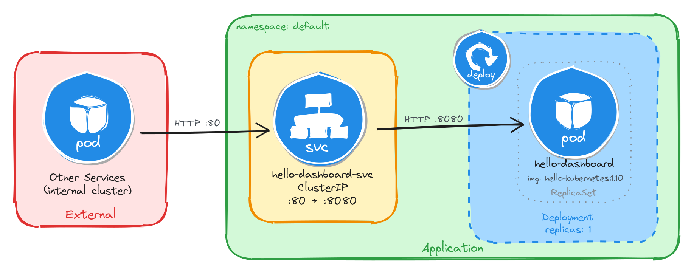

# 📦 Topic A: Single-Container Application Deployments

This module focuses on deploying single-container microservices isolated within the cluster network, exposed exclusively via `ClusterIP` Services to ensure strict internal access control.

---

## 📑 Core Tasks & Architectural Designs

### 1. Internal Dashboard (`hello-dashboard`)
* **Objective:** Deploy an internal cluster status dashboard unreachable from outside the cluster.
* **Service Mapping:** `Port 80` -> `TargetPort 8080`
* **Manifest:** [`01-hello-dashboard.yaml`](./01-hello-dashboard.yaml)



---

### 2. Request Inspector (`whoami-inspector`)
* **Objective:** Deploy an internal debugging tool to inspect HTTP request headers and client source IPs.
* **Service Mapping:** `Port 8080` -> `TargetPort 80`
* **Manifest:** [`02-whoami-inspector.yaml`](./02-whoami-inspector.yaml)


---

### 3. Pod Health Endpoint (`podinfo-health`)
* **Objective:** Expose runtime pod metadata and telemetry payload in JSON format internally.
* **Service Mapping:** `Port 9090` -> `TargetPort 9898`
* **Manifest:** [`03-podinfo-health.yaml`](./03-podinfo-health.yaml)


---

### 4. Server Welcome Page (`nginx-welcome`)
* **Objective:** Provide a lightweight internal web endpoint returning hostname and request URI details.
* **Service Mapping:** `Port 3000` -> `TargetPort 80`
* **Manifest:** [`04-nginx-welcome.yaml`](./04-nginx-welcome.yaml)


---

### 5. Payload Echo Service (`echo-service`)
* **Objective:** Provide an internal mirroring service to validate HTTP payload payloads sent by other cluster workloads.
* **Service Mapping:** `Port 8080` -> `TargetPort 8080`
* **Manifest:** [`05-echo-service.yaml`](./05-echo-service.yaml)


---

## 🚀 Execution & Verification

### 1. Deploy All Workloads
Apply all manifests in this directory simultaneously:

```bash
kubectl apply -f .
```

### 2. Verify Resource Status
Ensure all Pods and ClusterIP Services are running properly:

```bash
kubectl get pods
kubectl get svc
```

### 3. Test Internal Connectivity Across All Services
Run a temporary `busybox` Pod to verify internal DNS resolution and port mapping for each deployment:

```bash
# Task A.1: Hello Dashboard (Port 80)
kubectl run -it --rm test-a1 --image=busybox -- wget -qO- http://hello-dashboard-svc:80

# Task A.2: Whoami Inspector (Port 8080)
kubectl run -it --rm test-a2 --image=busybox -- wget -qO- http://whoami-inspector-svc:8080

# Task A.3: Podinfo Health (Port 9090)
kubectl run -it --rm test-a3 --image=busybox -- wget -qO- http://podinfo-health-svc:9090

# Task A.4: Nginx Welcome Page (Port 3000)
kubectl run -it --rm test-a4 --image=busybox -- wget -qO- http://nginx-welcome-svc:3000

# Task A.5: Echo Service (Port 8080)
kubectl run -it --rm test-a5 --image=busybox -- wget -qO- http://echo-service-svc:8080
```