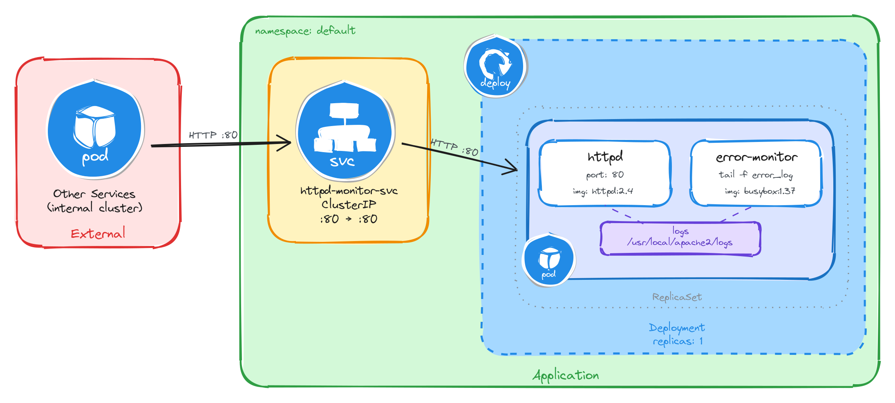

# Topic B: Multi-Container Application Deployment & Sidecar Patterns

This directory contains implementations for multi-container Pod design patterns using Kubernetes Deployments, shared volumes (`emptyDir`), and internal `ClusterIP` Services.

---

## 🛠️ Summary of Applications & Services

| Task | Application | Sidecar Pattern | Service Name | Service Type | Port Mapping |
| :--- | :--- | :--- | :--- | :--- | :--- |
| **B.1** | Nginx (`1.27`) | Logging Sidecar (`busybox:1.37`) | `nginx-sidecar-svc` | ClusterIP | `80:80` |
| **B.2** | Apache Httpd (`2.4`) | Error Monitor Sidecar (`busybox:1.37`) | `httpd-monitor-svc` | ClusterIP | `80:80` |
| **B.3** | Apache Tomcat (`11.0`) | Access Logger Sidecar (`busybox:1.37`) | `tomcat-logger-svc` | ClusterIP | `80:8080` |
| **B.4** | Apache Httpd (`2.4`) | CLF-to-CSV Adapter Sidecar (`busybox:1.37` + awk) | `httpd-adapter-svc` | ClusterIP | `80:80` |
| **B.5** | Nginx (`1.27`) | Content Sync Sidecar (`busybox:1.37`) | `nginx-content-svc` | ClusterIP | `80:80` |

---

## 📐 Architecture & Implementations

### Task B.1: Nginx Web Server with Logging Sidecar
Streams Nginx access logs from a shared volume directly to standard output via a busybox sidecar.


```bash
# Deploy manifest & expose service
kubectl apply -f 01-nginx-logging-sidecar.yaml
kubectl expose deployment nginx-with-sidecar --name=nginx-sidecar-svc --type=ClusterIP --port=80 --target-port=80

# Verify sidecar output
POD_NAME=$(kubectl get pods -l app=nginx-with-sidecar -o jsonpath='{.items[0].metadata.name}')
kubectl logs $POD_NAME -c log-sidecar
```

---

### Task B.2: Httpd Web Server with Error Monitoring Sidecar
Monitors Apache error logs continuously via a shared volume without modifying container access directly.



```bash
# Deploy manifest & expose service
kubectl apply -f 02-httpd-error-monitor.yaml
kubectl expose deployment httpd-with-monitor --name=httpd-monitor-svc --type=ClusterIP --port=80 --target-port=80

# Verify sidecar output
POD_NAME=$(kubectl get pods -l app=httpd-with-monitor -o jsonpath='{.items[0].metadata.name}')
kubectl logs $POD_NAME -c error-monitor
```

---

### Task B.3: Java Tomcat App Server with Access Logging Sidecar
Features readiness probing for JVM startup delays and streams dynamic Tomcat access log files to standard output.


```bash
# Deploy manifest & expose service
kubectl apply -f 03-tomcat-access-logger.yaml
kubectl expose deployment tomcat-with-logger --name=tomcat-logger-svc --type=ClusterIP --port=80 --target-port=8080

# Verify sidecar output
POD_NAME=$(kubectl get pods -l app=tomcat-with-logger -o jsonpath='{.items[0].metadata.name}')
kubectl logs $POD_NAME -c access-logger
```

---

### Task B.4: Httpd Web Server with Log Adapter Sidecar (CLF to CSV)
Converts raw Common Log Format (CLF) logs into CSV format on-the-fly using `awk` stream processing inside the sidecar.


```bash
# Deploy manifest & expose service
kubectl apply -f 04-httpd-log-adapter.yaml
kubectl expose deployment httpd-with-adapter --name=httpd-adapter-svc --type=ClusterIP --port=80 --target-port=80

# Verify transformed sidecar output
POD_NAME=$(kubectl get pods -l app=httpd-with-adapter -o jsonpath='{.items[0].metadata.name}')
kubectl logs $POD_NAME -c log-adapter
```

---

### Task B.5: Nginx Web Server with Content Sync Sidecar
Demonstrates a reversed sidecar pattern where the sidecar continuously generates dynamic HTML status pages into a shared volume every 30 seconds for Nginx to serve.


```bash
# Deploy manifest & expose service
kubectl apply -f 05-nginx-content-syncer.yaml
kubectl expose deployment nginx-with-syncer --name=nginx-content-svc --type=ClusterIP --port=80 --target-port=80

# Verify dynamic content generation from internal test pod
kubectl run -it --rm --restart=Never busybox --image=busybox -- wget -qO- http://nginx-content-svc
```