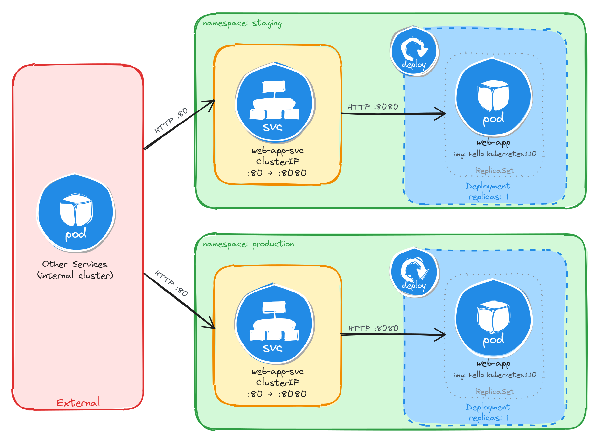
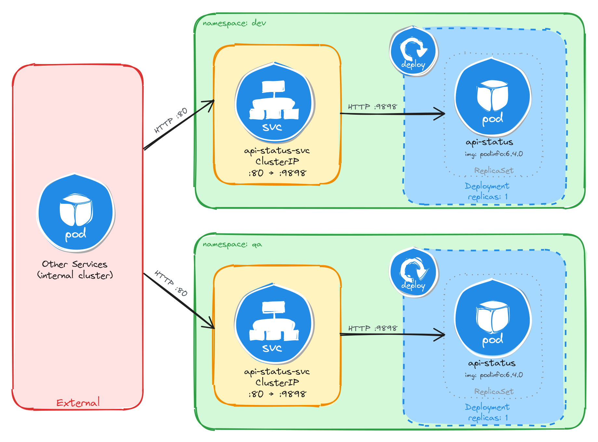
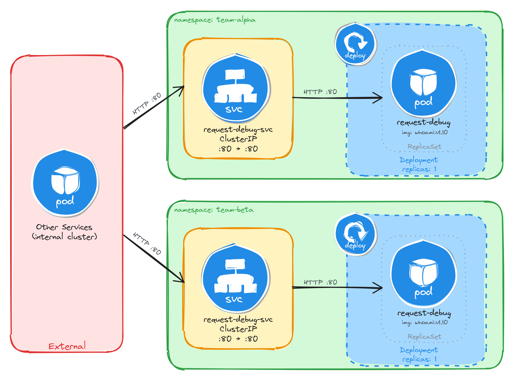
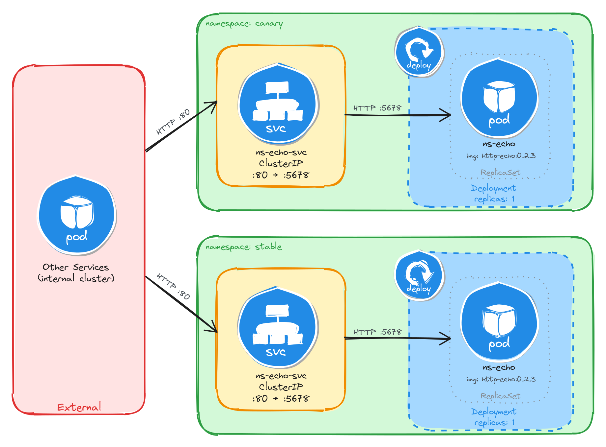

# Topic C: Namespace-Isolated Application Deployment

This directory contains implementations for deploying multi-environment applications isolated using Kubernetes Namespaces, Downward API metadata injection, dynamic startup arguments, and internal `ClusterIP` Services.

---

## 🛠️ Summary of Environments & Services

| Task | Application | Image | Target Namespaces | Service Name | Service Type | Port Mapping |
| :--- | :--- | :--- | :--- | :--- | :--- | :--- |
| **C.1** | Hello Kubernetes | `paulbouwer/hello-kubernetes:1.10` | `staging`, `production` | `web-app-svc` | ClusterIP | `80:8080` |
| **C.2** | Podinfo API Status | `stefanprodan/podinfo:6.4.0` | `dev`, `qa` | `api-status-svc` | ClusterIP | `80:9898` |
| **C.3** | Traefik Whoami Debug | `traefik/whoami:v1.10` | `team-alpha`, `team-beta` | `request-debug-svc` | ClusterIP | `80:80` |
| **C.4** | HTTP Echo Verifier | `hashicorp/http-echo:0.2.3` | `canary`, `stable` | `ns-echo-svc` | ClusterIP | `80:5678` |
| **C.5** | Nginx Hello Welcome Page | `nginxdemos/hello:plain-text` | `blue`, `green` | `ns-welcome-svc` | ClusterIP | `8080:80` |

---

## 📐 Architecture & Implementations

### Task C.1: Web Application in Staging and Production Namespaces
Deploys `hello-kubernetes` to isolated `staging` and `production` namespaces using Downward API to display the active environment.



```bash
# Create namespaces
kubectl create namespace staging
kubectl create namespace production

# Deploy manifests
kubectl apply -f 01-web-app-staging-prod.yaml -n staging
kubectl apply -f 01-web-app-staging-prod.yaml -n production

# Expose internal services
kubectl expose deployment web-app -n staging --name=web-app-svc --type=ClusterIP --port=80 --target-port=8080
kubectl expose deployment web-app -n production --name=web-app-svc --type=ClusterIP --port=80 --target-port=8080

# Verify cross-namespace isolation via FQDN vs short name
kubectl run -n staging -it --rm --restart=Never busybox --image=busybox -- wget -qO- http://web-app-svc
kubectl run -it --rm --restart=Never busybox --image=busybox -- wget -qO- [http://web-app-svc.production.svc.cluster.local](http://web-app-svc.production.svc.cluster.local)
```

---

### Task C.2: API Status Endpoint in Dev and QA Namespaces
Deploys `podinfo` microservices into `dev` and `qa` namespaces with dynamically injected JSON message payloads.



```bash
# Create namespaces
kubectl create namespace dev
kubectl create namespace qa

# Deploy manifests
kubectl apply -f 02-api-status-dev-qa.yaml -n dev
kubectl apply -f 02-api-status-dev-qa.yaml -n qa

# Expose internal services
kubectl expose deployment api-status -n dev --name=api-status-svc --type=ClusterIP --port=80 --target-port=9898
kubectl expose deployment api-status -n qa --name=api-status-svc --type=ClusterIP --port=80 --target-port=9898

# Test JSON response
kubectl run -n dev -it --rm --restart=Never busybox --image=busybox -- wget -qO- http://api-status-svc
```

---

### Task C.3: Request Debugging Tool in Team-Isolated Namespaces
Deploys HTTP header reflection tools (`whoami`) for `team-alpha` and `team-beta` isolated development teams.



```bash
# Create namespaces
kubectl create namespace team-alpha
kubectl create namespace team-beta

# Deploy manifests
kubectl apply -f 03-request-debug-teams.yaml -n team-alpha
kubectl apply -f 03-request-debug-teams.yaml -n team-beta

# Expose internal services
kubectl expose deployment request-debug -n team-alpha --name=request-debug-svc --type=ClusterIP --port=80 --target-port=80
kubectl expose deployment request-debug -n team-beta --name=request-debug-svc --type=ClusterIP --port=80 --target-port=80

# Verify team isolation
kubectl run -n team-alpha -it --rm --restart=Never busybox --image=busybox -- wget -qO- http://request-debug-svc
```

---

### Task C.4: Namespace Verification Endpoint in Canary and Stable Namespaces
Deploys plain-text echo endpoints to `canary` and `stable` environments, substituting Downward API environment variables into container startup arguments.



```bash
# Create namespaces
kubectl create namespace canary
kubectl create namespace stable

# Deploy manifests
kubectl apply -f 04-ns-echo-canary-stable.yaml -n canary
kubectl apply -f 04-ns-echo-canary-stable.yaml -n stable

# Expose internal services
kubectl expose deployment ns-echo -n canary --name=ns-echo-svc --type=ClusterIP --port=80 --target-port=5678
kubectl expose deployment ns-echo -n stable --name=ns-echo-svc --type=ClusterIP --port=80 --target-port=5678

# Verify response
kubectl run -n canary -it --rm --restart=Never busybox --image=busybox -- wget -qO- http://ns-echo-svc
```

---

### Task C.5: Internal Welcome Page in Blue-Green Namespaces
Deploys plain-text server information endpoints (`nginxdemos/hello:plain-text`) to `blue` and `green` namespaces where environment identity is verified through unique ReplicaSet pod names.


```bash
# Create namespaces
kubectl create namespace blue
kubectl create namespace green

# Deploy manifests
kubectl apply -f 05-ns-welcome-blue-green.yaml -n blue
kubectl apply -f 05-ns-welcome-blue-green.yaml -n green

# Expose internal services
kubectl expose deployment ns-welcome -n blue --name=ns-welcome-svc --type=ClusterIP --port=8080 --target-port=80
kubectl expose deployment ns-welcome -n green --name=ns-welcome-svc --type=ClusterIP --port=8080 --target-port=80

# Verify response
kubectl run -n blue -it --rm --restart=Never busybox --image=busybox -- wget -qO- http://ns-welcome-svc:8080
```