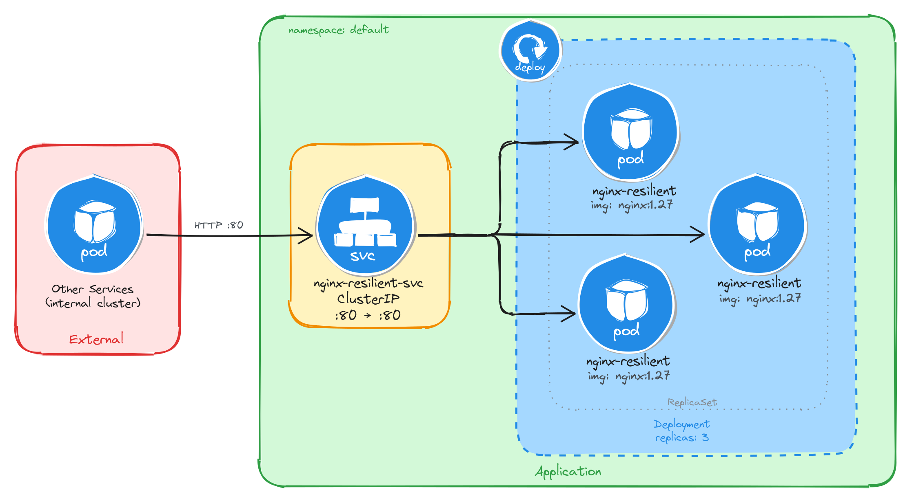
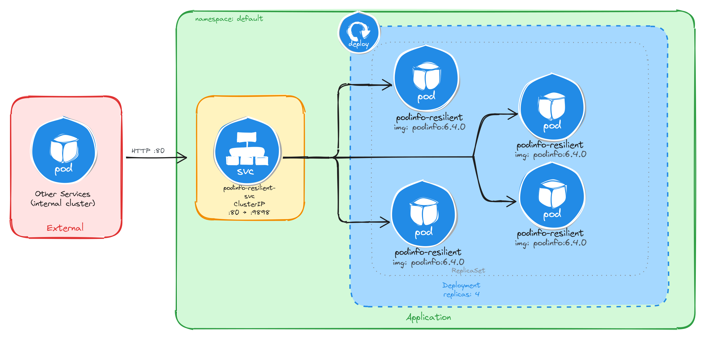

# Topic D: Resilient Application Deployment

This directory contains implementations demonstrating resilient application architectures using Kubernetes **Deployments**, **ReplicaSets**, **Self-Healing mechanisms**, and cluster-internal **ClusterIP Load Balancing**.

---

## 🛠️ Summary of Resilient Services

| Task | Workload | Image | Replicas | Service Name | Service Type | Port Mapping | Key Architectural Objective |
| :--- | :--- | :--- | :---: | :--- | :--- | :--- | :--- |
| **D.1** | Resilient Web Server | `nginx:1.27` | 3 | `nginx-resilient-svc` | ClusterIP | `80:80` | High availability & self-healing across Pod failures |
| **D.2** | Resilient API Service | `stefanprodan/podinfo:6.4.0` | 4 | `podinfo-resilient-svc` | ClusterIP | `80:9898` | Internal round-robin load balancing & replica verification |

---

## 📐 Architecture & Implementations

### Task D.1: Resilient Web Server with Multiple Replicas
Deploys a multi-replica NGINX web server to ensure zero-downtime availability during Pod crashes, rescheduling, or evictions.



#### Implementation & Verification Steps

```bash
# Apply Deployment and Service manifests
kubectl apply -f 01-nginx-resilient.yaml

# Verify running Pods and ReplicaSet ownership
kubectl get pods -l app=nginx-resilient
kubectl get replicasets -l app=nginx-resilient

# Inspect full ownership hierarchy (Deployment -> ReplicaSet -> Pod)
kubectl describe pod $(kubectl get pods -l app=nginx-resilient -o jsonpath='{.items[0].metadata.name}') | grep 'Controlled By'

# Verify Self-Healing Behavior (delete a pod and watch it regenerate)
POD_NAME=$(kubectl get pods -l app=nginx-resilient -o jsonpath='{.items[0].metadata.name}')
kubectl delete pod $POD_NAME

# Test ClusterIP load balancing using Busybox
kubectl run -it --rm --restart=Never busybox --image=busybox -- sh -c 'for i in $(seq 1 9); do wget -qO- http://nginx-resilient-svc > /dev/null && echo "request $i done"; done'

# Check logs across all replicas to verify distributed traffic
for pod in $(kubectl get pods -l app=nginx-resilient -o name); do echo "=== $pod ==="; kubectl logs $pod | grep "GET /"; done
```

---

### Task D.2: Resilient API Service with Multiple Replicas
Deploys a multi-replica `podinfo` microservice to demonstrate automated internal load balancing and hostname resolution across independent Pod instances.



#### Implementation & Verification Steps

```bash
# Apply Deployment and Service manifests
kubectl apply -f 02-podinfo-resilient.yaml

# Verify resource creation and ClusterIP assignment
kubectl get pods -l app=podinfo-resilient
kubectl get svc podinfo-resilient-svc

# Verify ReplicaSet desired vs ready count
kubectl get replicasets -l app=podinfo-resilient

# Test round-robin load balancing across 4 replicas
kubectl run -it --rm --restart=Never busybox --image=busybox -- sh -c 'for i in $(seq 1 8); do wget -qO- http://podinfo-resilient-svc | grep "\"hostname\""; done'
```

#### Sample Load Balancer Verification Output
```text
"hostname": "podinfo-resilient-5b8c7d9f64-7r3qw"
"hostname": "podinfo-resilient-5b8c7d9f64-d4x9m"
"hostname": "podinfo-resilient-5b8c7d9f64-p6v2t"
"hostname": "podinfo-resilient-5b8c7d9f64-h9c3f"
"hostname": "podinfo-resilient-5b8c7d9f64-7r3qw"
"hostname": "podinfo-resilient-5b8c7d9f64-d4x9m"
"hostname": "podinfo-resilient-5b8c7d9f64-p6v2t"
"hostname": "podinfo-resilient-5b8c7d9f64-h9c3f"
```