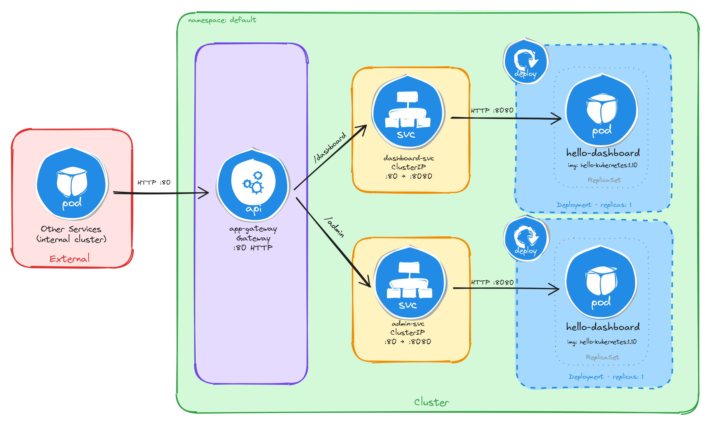

# Topic E: Internet-Facing Application Deployment (Kubernetes Gateway API)

This directory contains implementations for exposing internal Kubernetes workloads externally using the **Kubernetes Gateway API** standard backed by **NGINX Gateway Fabric**.

---

## 🛠️ Prerequisites & Controller Setup

Before applying task resources, install the Gateway API CRDs and NGINX Gateway Fabric controller:

```bash
# 1. Install Gateway API CRDs (v1.2.0)
kubectl apply -f [https://github.com/kubernetes-sigs/gateway-api/releases/download/v1.2.0/standard-install.yaml](https://github.com/kubernetes-sigs/gateway-api/releases/download/v1.2.0/standard-install.yaml)

# 2. Install NGINX Gateway Fabric CRDs & Controller
kubectl apply -f [https://raw.githubusercontent.com/nginx/nginx-gateway-fabric/v1.6.2/deploy/crds.yaml](https://raw.githubusercontent.com/nginx/nginx-gateway-fabric/v1.6.2/deploy/crds.yaml)
kubectl apply -f [https://raw.githubusercontent.com/nginx/nginx-gateway-fabric/v1.6.2/deploy/default/deploy.yaml](https://raw.githubusercontent.com/nginx/nginx-gateway-fabric/v1.6.2/deploy/default/deploy.yaml)

# 3. Wait for NGINX Gateway Fabric to become ready
kubectl wait --timeout=5m -n nginx-gateway deployment/nginx-gateway --for=condition=Available

# 4. Verify GatewayClass acceptance
kubectl get gatewayclass
```

---

## 📊 Task Summary

| Task | Workloads | Image | Routing Mechanism | Service Type | Exposed Endpoint |
| :--- | :--- | :--- | :--- | :--- | :--- |
| **E.1** | Dashboard & Admin Panel | `paulbouwer/hello-kubernetes:1.10` | **Path-Based** (`/dashboard`, `/admin`) + `URLRewrite` | ClusterIP + Gateway | NodePort / Port 80 |
| **E.2** | API Service & Web Frontend | `paulbouwer/hello-kubernetes:1.10` | **Host-Based** (`api.example.com`, `web.example.com`) | ClusterIP + Gateway | NodePort / Port 80 |

---

## 📐 Architecture & Implementations

### Task E.1: Public-Facing Application with Path-Based Routing
Exposes internal `dashboard-svc` and `admin-svc` ClusterIP services via a single Gateway instance using path prefix matching and `URLRewrite` filters.



#### Deployment & Verification Steps

```bash
# Apply complete path-based manifests
kubectl apply -f 01-path-based-routing.yaml

# Verify Deployments, Services, Gateway, and HTTPRoute status
kubectl get pods -l 'app in (dashboard, admin)'
kubectl get svc dashboard-svc admin-svc
kubectl get gateway app-gateway
kubectl get httproute app-routes

# Capture Node IP and NodePort for Gateway access
NODE_IP=$(kubectl get nodes -o jsonpath='{.items[0].status.addresses[0].address}')
NODE_PORT=$(kubectl get svc -n nginx-gateway -o jsonpath='{.items[0].spec.ports[0].nodePort}')

# Test path routing via curl
curl -s http://$NODE_IP:$NODE_PORT/dashboard | grep -A2 'message'
curl -s http://$NODE_IP:$NODE_PORT/admin | grep -A2 'message'
```

---

### Task E.2: Public-Facing Application with Host-Based Routing
Exposes internal `api-svc` and `web-svc` microservices using host-based header matching (`Host: api.example.com` and `Host: web.example.com`) bound to a single Gateway instance.


#### Deployment & Verification Steps

```bash
# Apply complete host-based manifests
kubectl apply -f 02-host-based-routing.yaml

# Verify Deployments, Services, Gateway, and HTTPRoutes
kubectl get pods -l 'app in (api, web)'
kubectl get svc api-svc web-svc
kubectl get gateway app-gateway
kubectl get httproute api-route web-route

# Capture Node IP and NodePort for Gateway access
NODE_IP=$(kubectl get nodes -o jsonpath='{.items[0].status.addresses[0].address}')
NODE_PORT=$(kubectl get svc -n nginx-gateway -o jsonpath='{.items[0].spec.ports[0].nodePort}')

# Test host-based routing via HTTP Host Headers
curl -s -H "Host: api.example.com" http://$NODE_IP:$NODE_PORT/ | grep -A2 'message'
curl -s -H "Host: web.example.com" http://$NODE_IP:$NODE_PORT/ | grep -A2 'message'
```